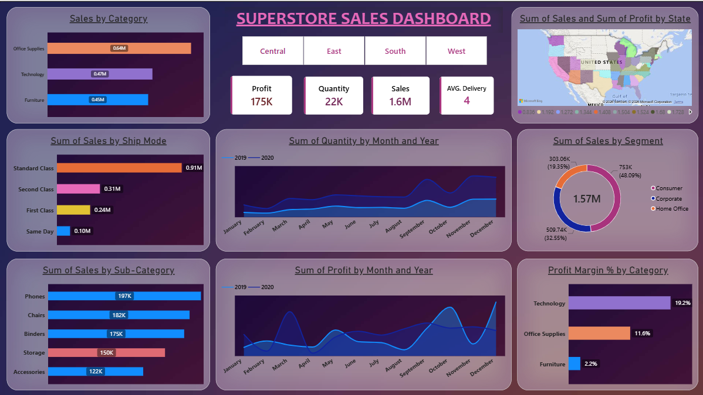

# SuperStore Sales Dashboard (Power BI)



An interactive Power BI dashboard analysing sales, profit, shipping and customer segments for a fictional US retailer (SuperStore), covering orders from 2019 and 2020.

## Business questions

- Which categories, sub-categories and regions drive sales, and which actually drive profit?
- How do sales, quantity and profit move month to month and year over year?
- Which ship modes and customer segments matter most, and how long does delivery take?
- Where (by state) is the business making or losing money?

## Key insights

| Metric | Value |
|---|---|
| Total sales | $1.57M |
| Total profit | $175K (11.2% margin) |
| Units sold | 22.3K |
| Average delivery time | about 4 days |
| Orders | 3,003 |

1. **Growth came at the cost of margin.** Sales grew about 77% from 2019 ($565K) to 2020 ($1.0M), but profit rose only about 14% ($82K to $93K). Profit margin fell from roughly 14.5% to 9.3%.
2. **Office Supplies leads on sales, Technology on profit.** Office Supplies brings in the most revenue ($644K), but Technology earns the most profit ($90K, 19% margin). Furniture has $452K in sales but only a 2.2% margin.
3. **Top sub-categories by sales** are Phones ($197K), Chairs ($182K), Binders ($175K), Storage ($150K) and Accessories ($122K).
4. **Some sub-categories lose money.** Tables (-$11.1K), Supplies (-$1.7K) and Bookcases (-$0.3K) are unprofitable, and Machines break even. Copiers are the standout, with a 72% margin on $60K in sales.
5. **West is the strongest region, Central the weakest.** West has the highest sales ($522K) and margin (13.0%). Central has an 8.0% margin despite $341K in sales.
6. **A few states drag profit down.** Texas (-$14.1K), Illinois (-$9.6K), Ohio (-$9.3K) and Pennsylvania (-$9.3K) all lose money, while California ($49K) and New York ($41K) lead.
7. **Standard Class is the default shipping choice.** It accounts for $912K of sales (about 58%) and takes around 5 days on average. First Class takes about 2 days and Same Day under a day.
8. **Consumers are the largest segment** at 48% of sales ($753K), followed by Corporate (33%) and Home Office (19%). Margins are similar across segments (about 11-12%).
9. **Sales are seasonal.** Sales and quantity climb through the second half of the year, peaking in November and December.

## Dashboard features

- Region slicer (Central / East / South / West) that filters every visual
- KPI cards: Profit, Quantity, Sales, Average Delivery (days)
- Sales by Category and Ship Mode
- Top 5 Sub-Categories by Sales
- Profit Margin % by Category
- Sales by Segment donut
- Filled map of sales and profit by state
- Monthly quantity and profit trends, 2019 vs 2020

## DAX used

```dax
Ave_Delivery = DATEDIFF(SuperStore_Sales_Dataset[Order Date], SuperStore_Sales_Dataset[Ship Date], DAY)

total_sales = SUM(SuperStore_Sales_Dataset[Sales])

Profit Margin % = DIVIDE(SUM(SuperStore_Sales_Dataset[Profit]), SUM(SuperStore_Sales_Dataset[Sales]))
```

## Data

`SuperStore_Sales_Dataset.csv` is the original, uncleaned source file with 5,901 order lines. It includes order and ship dates, ship mode, customer segment, location (city, state, region), product category and sub-category, sales, quantity, profit, returns and payment mode. Dates are in `dd-mm-yyyy` format.

**Cleaning done in Power Query (inside the .pbix):**
- Removed the empty `ind1` and `ind2` columns
- Converted date columns to Date type
- Added the `Ave_Delivery` calculated column (days between order and ship date)

**Data note:** Returns are recorded only for 2020 orders (none for 2019), so any return analysis covers 2020 only and the overall return rate is understated.

## How to open

1. Install [Power BI Desktop](https://powerbi.microsoft.com/desktop/) (Windows only)
2. Download `SuperStore dashboard.pbix` and `SuperStore_Sales_Dataset.csv` from this repo
3. If prompted, point the data source to the downloaded CSV (use the original file, since the cleaning steps expect its columns)

## Repo contents

```
├── SuperStore_Sales_Dashboard.pbix
├── SuperStore_Sales_Dataset.csv
├── images/
│   └── dashboard.png
└── README.md
```

## Tools

Power BI Desktop, Power Query, DAX, data modelling and visualisation.